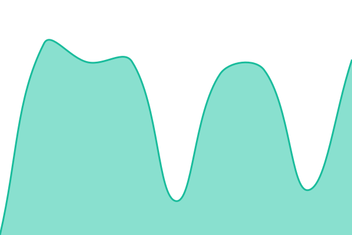
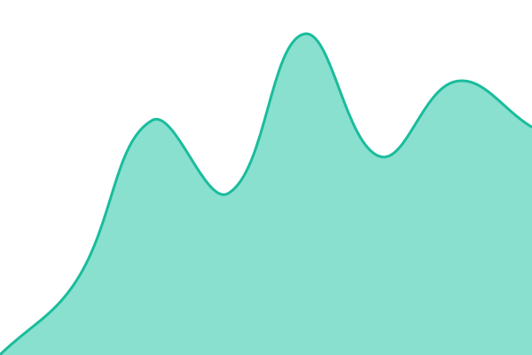
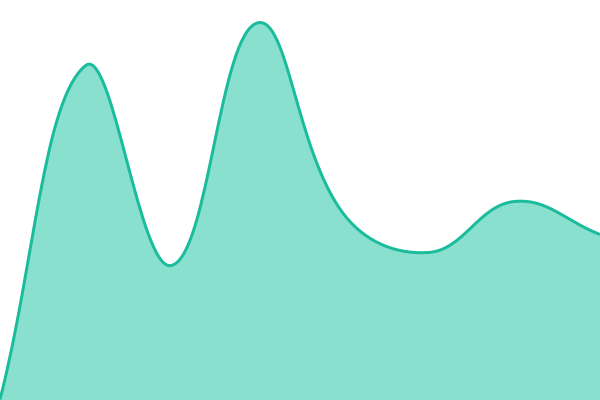

# USB Platform Status

Live status page for the USB headless platform: **dfwmow.app** (production site),
the headless API's preview-status auth gate, the **lab draft**, and the sister
properties **dfwmetro.net** and **testmyself.app**.

**Status page:** https://cexplayer01.github.io/usb-status/

Powered by [Upptime](https://github.com/upptime/upptime) (MIT) — uptime checks
run every 5 minutes in GitHub Actions, response times are committed to
`history/`, incidents are tracked as GitHub Issues, and the static page is
served from GitHub Pages. No server, nothing always-on.

Configuration lives in [`.upptimerc.yml`](.upptimerc.yml). The workflow files
under `.github/workflows/` are generated from the Upptime template — edit the
config, not the workflows.

<!--start: status pages-->
<!-- This summary is generated by Upptime (https://github.com/upptime/upptime) -->
<!-- Do not edit this manually, your changes will be overwritten -->
<!-- prettier-ignore -->
| URL | Status | History | Response Time | Uptime |
| --- | ------ | ------- | ------------- | ------ |
|  [dfwmow.app (production site)](https://dfwmow.app) | 🟩 Up | [dfwmow-app-production-site.yml](https://github.com/cexplayer01/usb-status/commits/HEAD/history/dfwmow-app-production-site.yml) | 

 445ms
     
 | 

<a href="https://cexplayer01.github.io/usb-status/history/dfwmow-app-production-site">100.00%</a>
    

|  [Headless API — preview status (auth gate)](https://dfwmow.app/api/usb/preview?job_id=publication-job-000000000000000000000000) | 🟩 Up | [headless-api-preview-status-auth-gate.yml](https://github.com/cexplayer01/usb-status/commits/HEAD/history/headless-api-preview-status-auth-gate.yml) | 

 1487ms
     
 | 

<a href="https://cexplayer01.github.io/usb-status/history/headless-api-preview-status-auth-gate">100.00%</a>
    

|  [Lab draft](https://usb-lab--dfwmow.netlify.app) | 🟩 Up | [lab-draft.yml](https://github.com/cexplayer01/usb-status/commits/HEAD/history/lab-draft.yml) | 

 583ms
     
 | 

<a href="https://cexplayer01.github.io/usb-status/history/lab-draft">100.00%</a>
    

|  [dfwmetro.net (sister property)](https://dfwmetro.net) | 🟩 Up | [dfwmetro-net-sister-property.yml](https://github.com/cexplayer01/usb-status/commits/HEAD/history/dfwmetro-net-sister-property.yml) | 

 547ms
     
 | 

<a href="https://cexplayer01.github.io/usb-status/history/dfwmetro-net-sister-property">100.00%</a>
    

|  [testmyself.app (sister property)](https://testmyself.app) | 🟩 Up | [testmyself-app-sister-property.yml](https://github.com/cexplayer01/usb-status/commits/HEAD/history/testmyself-app-sister-property.yml) | 

 523ms
     
 | 

<a href="https://cexplayer01.github.io/usb-status/history/testmyself-app-sister-property">100.00%</a>
    

<!--end: status pages-->
